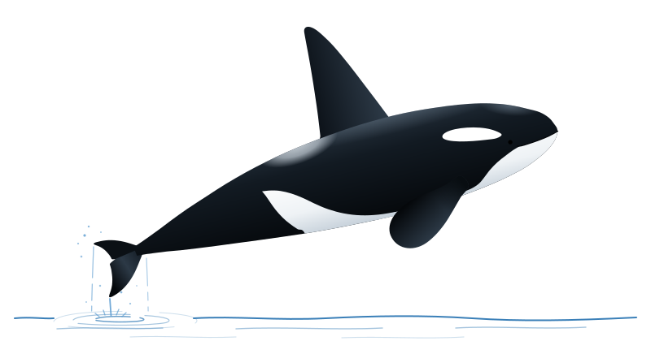

  <picture>
    <source media="(prefers-color-scheme: dark)" srcset="assets/orca-dark.svg">
    <source media="(prefers-color-scheme: light)" srcset="assets/orca.svg">
    
  </picture>

<h1 align="center">xpan0988</h1>

Undergrad · indie developer · building things I actually want to use

## About me

- Undergraduate student <!-- school / major -->
- Most of my time goes into indie projects: small, focused tools I use myself
- Currently writing a position paper <!-- topic -->

## Featured projects

| Project | Description |
| --- | --- |
| [Pastey](https://github.com/xpan0988/Pastey) | <!-- one-line description --> |
| [clawd-bot](https://github.com/xpan0988/clawd-bot) | <!-- one-line description --> |

## Tech stack

- **Languages:** <!-- e.g. TypeScript, Python -->
- **Frameworks:** <!-- ... -->
- **Tools:** <!-- ... -->

## Contact

- Email: <!-- you@example.com -->
- Website: <!-- https://example.com -->

  

