<picture>
  <source media="(prefers-color-scheme: dark)" srcset="assets/orca-dark.svg">
  <source media="(prefers-color-scheme: light)" srcset="assets/orca-light.svg">
  
</picture>

### Hi, I'm Pan

Undergrad · indie developer · building things I actually want to use

**Now** — working on [Pastey](https://github.com/xpan0988/Pastey) and [clawd-bot](https://github.com/xpan0988/clawd-bot), and writing a position paper.

| Project | |
|---|---|
| [Pastey](https://github.com/xpan0988/Pastey) | <!-- one line --> |
| [clawd-bot](https://github.com/xpan0988/clawd-bot) | <!-- one line --> |

<!-- Website · Email -->

The orca is generated from math, not drawn: a depth profile along an undulating spine, rasterised into glyphs frame by frame (`scripts/build_orca.py`). Idea from [dsh-ascii-sharks](https://github.com/OGHong/dsh-ascii-sharks).
